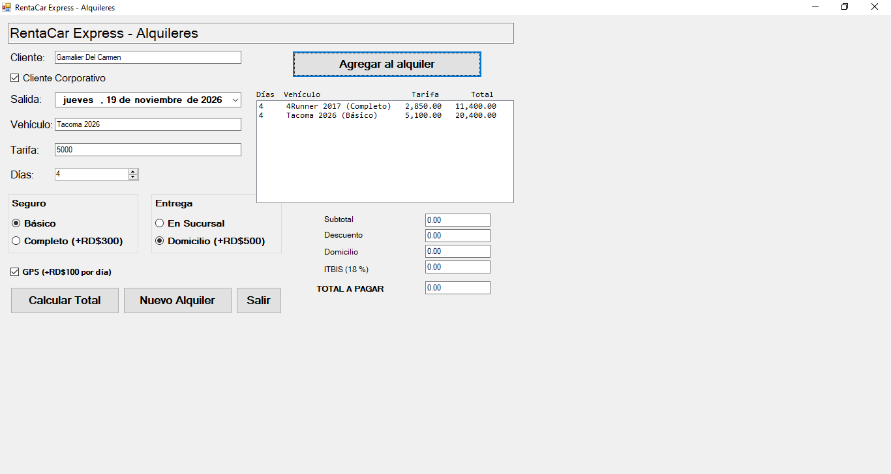
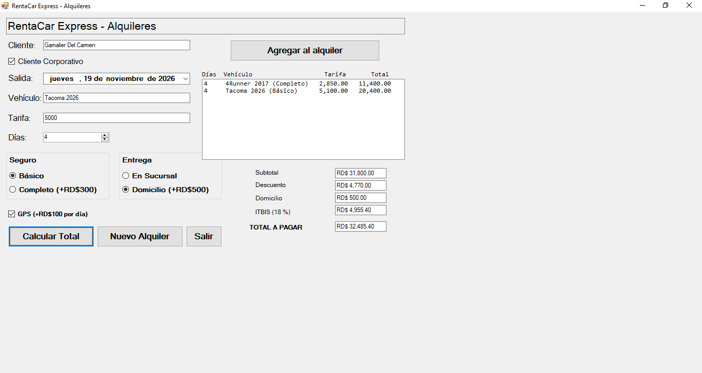
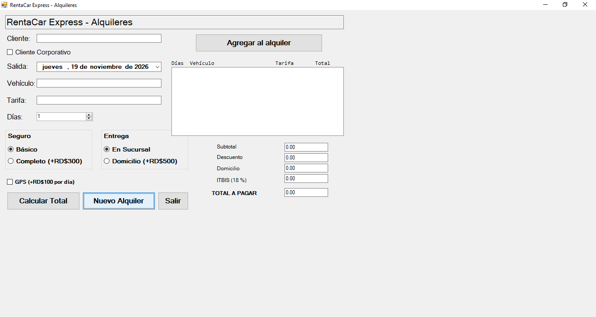

# RentaCar Express
### Sistema de Registro y Alquiler de Vehículos

## 1. Nombre y matrícula

**Estudiante:** Paul Francisco Santana Alemán  
**Matrícula:** 2026-1834  
**Asignatura:** Programación Básica  
**Proyecto:** Examen práctico – RentaCar Express  
**Lenguaje de programación:** C#  
**Entorno de desarrollo:** Visual Studio  
**Tipo de aplicación:** Windows Forms

---

## 2. Descripción del programa

RentaCar Express es una aplicación de escritorio desarrollada en C# utilizando Windows Forms. Su objetivo es facilitar el registro de alquileres de vehículos y calcular el monto total que debe pagar cada cliente.

El programa permite registrar varios vehículos en un mismo alquiler, establecer la tarifa diaria, seleccionar la cantidad de días y agregar servicios adicionales como seguro completo y GPS.

También permite aplicar descuentos a clientes corporativos, agregar el costo de entrega a domicilio y calcular el ITBIS correspondiente.

La aplicación cuenta con una interfaz sencilla que permite introducir los datos, agregar vehículos, calcular el total, iniciar un nuevo alquiler y salir del sistema.

## 3. Datos de entrada

Los datos que recibe el programa son:

- **Cliente:** nombre de la persona que realiza el alquiler.
- **Fecha de salida:** fecha seleccionada para el alquiler.
- **Cliente corporativo:** indica si corresponde aplicar un descuento.
- **Vehículo:** nombre o modelo del vehículo alquilado.
- **Tarifa:** precio diario del vehículo en pesos dominicanos.
- **Días:** cantidad de días del alquiler.
- **Seguro:** selección entre básico y completo.
- **GPS:** indica si el cliente solicita este servicio.
- **Entrega:** selección entre recoger en sucursal o recibir a domicilio.

## 4. Proceso

El programa realiza las siguientes operaciones:

**Registro del vehículo**

Se introducen los datos del vehículo, la tarifa diaria y la cantidad de días.

**Cálculo de la tarifa diaria**

Si el cliente selecciona seguro completo, se agregan RD$300 a la tarifa diaria.

Si solicita GPS, se agregan RD$100 adicionales por día.

**Cálculo del alquiler**

La tarifa diaria, incluyendo los servicios adicionales, se multiplica por la cantidad de días.

Cada vehículo registrado se agrega a la lista y su costo se acumula en el subtotal.

**Descuento corporativo**

Si el cliente es corporativo, se aplica un descuento del 15 % sobre el subtotal.

**Entrega a domicilio**

Si el cliente solicita entrega a domicilio, se agregan RD$500 una sola vez al alquiler.

**Cálculo del ITBIS**

Se calcula la base imponible restando el descuento al subtotal y sumando el costo de domicilio.

Sobre esa cantidad se aplica el ITBIS del 18 %.

**Total final**

El total a pagar se obtiene sumando la base imponible y el ITBIS.

## 5. Salida

El programa muestra los siguientes resultados:

- Lista de vehículos registrados.
- Cantidad de días de alquiler.
- Tarifa diaria de cada vehículo.
- Costo total de cada vehículo.
- Subtotal acumulado.
- Descuento corporativo, cuando corresponde.
- Cargo por entrega a domicilio.
- ITBIS del 18 %.
- Total general a pagar.

Los resultados monetarios se presentan en pesos dominicanos (RD$), utilizando dos decimales.

**Ejemplo de funcionamiento**

En una prueba realizada con dos vehículos, el programa mostró los siguientes resultados:

| Concepto | Monto |
|---|---:|
| Subtotal | RD$97,800.00 |
| Descuento | RD$0.00 |
| Domicilio | RD$500.00 |
| ITBIS (18 %) | RD$17,694.00 |
| **Total a pagar** | **RD$115,994.00** |

## 6. Capturas de pantalla

### Registro de vehículos
Se muestran dos vehículos agregados al alquiler.

### Cálculo del total
Se muestra el subtotal, descuento corporativo,
entrega a domicilio, ITBIS y total a pagar.

### Nuevo alquiler
El formulario vuelve a sus valores iniciales
para registrar un nuevo alquiler.

